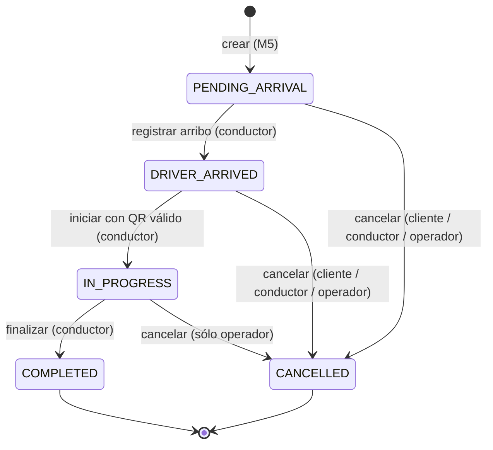

# M6 – Máquina de estados del viaje

> Cubre RF-6.1 (estados y transiciones), RF-6.3 a RF-6.7 (arribo, inicio, finalización y
> cancelaciones) y RF-6.8 (historial no destructivo).
> La implementación de referencia está en
> [`m6-viajes/src/trips/dominio`](../../m6-viajes/src/trips/dominio).

## Alcance del módulo

Un **viaje** se crea cuando M5 (Solicitud y Despacho) ya resolvió la asignación única de un
conductor. Las etapas previas (búsqueda de candidatos, ofertas y aceptación) corresponden a M5,
y las posteriores al cierre (cobro, comprobante y calificaciones) las resuelven otros módulos a
partir de los eventos que publica M6.

```
M5 asigna conductor ──POST /trips──▶ M6 administra el ciclo de vida ──eventos──▶ M7, M8, M5, M2/M3, M4, M9
```

## Estados

| Estado               | Significado                                                       | ¿Terminal? |
|----------------------|-------------------------------------------------------------------|:----------:|
| `PENDING_ARRIVAL`           | Hay conductor asignado y se dirige al punto de retiro.            | No         |
| `DRIVER_ARRIVED` | El conductor indicó que llegó al punto de retiro y espera.        | No         |
| `IN_PROGRESS`           | Se validó el código QR y el cliente está a bordo.                 | No         |
| `COMPLETED`         | El conductor cerró el viaje con distancia y duración.             | Sí         |
| `CANCELLED`          | Lo canceló el cliente, el conductor o un operador (con motivo).   | Sí         |

## Diagrama



## Tabla de transiciones

| Acción             | Desde                              | Hacia                | Quién puede                       | Precondiciones                                                         | Evento publicado     |
|--------------------|------------------------------------|----------------------|-----------------------------------|------------------------------------------------------------------------|----------------------|
| crear              | —                                  | `PENDING_ARRIVAL`           | Servicio M5                       | El `requestId` no tiene viaje, o tiene uno con los mismos datos (reintento). | `TripCreated`        |
| registrar arribo   | `PENDING_ARRIVAL`                         | `DRIVER_ARRIVED` | Conductor asignado                | —                                                                      | `DriverArrived`  |
| iniciar            | `DRIVER_ARRIVED`               | `IN_PROGRESS`           | Conductor asignado                | Código QR válido, vigente y no usado (lo valida M8; ver RF-6.4).        | `TripStarted`      |
| finalizar          | `IN_PROGRESS`                         | `COMPLETED`         | Conductor asignado                | Informa `distanceKm` ≥ 0.                                | `TripCompleted`    |
| cancelar           | `PENDING_ARRIVAL`, `DRIVER_ARRIVED`   | `CANCELLED`          | Cliente del viaje                 | Motivo permitido para clientes.                                         | `TripCancelled`     |
| cancelar           | `PENDING_ARRIVAL`, `DRIVER_ARRIVED`   | `CANCELLED`          | Conductor asignado                | Motivo permitido para conductores (ver espera mínima).                 | `TripCancelled`     |
| cancelar           | `PENDING_ARRIVAL`, `DRIVER_ARRIVED`, `IN_PROGRESS` | `CANCELLED` | Operador                          | Motivo permitido para operadores.                                       | `TripCancelled`     |

Cualquier otra combinación de acción y estado se rechaza con `409 INVALID_STATE_TRANSITION`. Si la
acción la intenta un actor que no está habilitado, se rechaza con `403 FORBIDDEN`. Los estados
terminales no admiten ninguna transición.

## Reglas de negocio

### R6-01. Pertenencia del actor
- Sólo el **conductor asignado** al viaje puede registrar arribo, iniciar, finalizar o
  cancelar como conductor.
- Sólo el **cliente del viaje** puede cancelar como cliente.
- El **operador** puede cancelar cualquier viaje no terminal (por ejemplo, ante un incidente).

### R6-02. Inicio validado (RF-6.4)
El viaje pasa a `IN_PROGRESS` sólo si el conductor presenta el código del QR que muestra el
cliente. Según RF-8.3, el QR temporal de un solo uso lo **genera M8**, y M6 le solicita a M8
que lo valide y lo consuma en el momento del inicio:

1. M8 genera el QR al recibir `TripCreated` y se lo muestra al cliente.
2. El conductor escanea el QR y la app envía el código a `POST /trips/{id}/start`.
3. M6 le pide a M8 que valide y consuma el código para ese `tripId`.
4. Si es válido, M6 pasa a `IN_PROGRESS`. Si no, responde `422 INVALID_VERIFICATION_CODE`.
   Si M8 no responde dentro del timeout, responde `503 DEPENDENCY_UNAVAILABLE`, nunca un
   bloqueo indefinido.

> **A acordar con M8:** el endpoint de validación y consumo del código (ver la sección de
> pending).

### R6-03. Cancelación y devolución al despacho (RF-6.6 y RF-6.7)
Cada cancelación registra quién canceló, el motivo (de una lista cerrada), un detalle
opcional y el estado en el que estaba el viaje.

| Rol       | Motivos permitidos                                                           |
|-----------|------------------------------------------------------------------------------|
| Cliente   | `CHANGE_OF_PLANS`, `EXCESSIVE_DELAY`, `DRIVER_NO_SHOW`, `OTHER`     |
| Conductor | `CLIENT_NO_SHOW`, `VEHICLE_PROBLEM`, `ORIGIN_UNREACHABLE`, `OTHER` |
| Operador  | `SECURITY_INCIDENT`, `ADMINISTRATIVE_BLOCK`, `OTHER`                    |

La cancelación marca `requiresRedispatch = true` (la solicitud vuelve a M5 para buscar otro
conductor) **sólo** cuando:
- cancela el **conductor**,
- el viaje todavía no había iniciado,
- y el motivo **no** es `CLIENT_NO_SHOW`, porque en ese caso el cliente no está.

### R6-04. Espera mínima antes de "cliente no se presentó"
El conductor sólo puede cancelar con `CLIENT_NO_SHOW` si el viaje está en
`DRIVER_ARRIVED` y pasaron al menos **`ESPERA_MINIMA_ARRIBO_MINUTOS`** (configurable, por
defecto 5) desde el arribo.

### R6-05. El cargo de cancelación no lo calcula M6
M6 sólo aplica las reglas de **estado**. El evento `TripCancelled` lleva todo lo que M7
necesita para decidir si corresponde un cargo (RF-7.4): quién canceló, el motivo, el estado
al cancelar y los instantes de asignación, arribo y cancelación.

### R6-06. Finalización (RF-6.5)
El conductor informa `distanceKm`. M6 calcula `durationSeconds` como
`completedAt − startedAt`. Con esos datos M7 calcula el importe final y M8 emite el
comprobante.

### R6-07. Historial no destructivo (RF-6.8)
- Cada transición agrega un registro **inmutable** al historial con número de secuencia,
  estado desde y hacia, acción, actor (rol e id), fecha, y motivo y detalle si los hay.
- Nunca se modifica ni se borra un registro del historial. La creación también se registra,
  con estado desde `null`.

### R6-08. Concurrencia (RNF-08)
- Cada viaje tiene un número de `version` que aumenta con cada transición.
- Al persistir, la actualización es **condicional** (`UPDATE ... WHERE id = ? AND version = ?`).
  Si dos pedidos concurrentes intentan, por ejemplo, finalizar el mismo viaje, sólo uno se
  aplica; el otro recibe `409` porque el estado o la versión ya cambiaron. De esta forma se
  evita la doble finalización.
- La API expone la versión como `ETag`. Los clientes pueden mandar `If-Match` para asegurar
  que actúan sobre la versión que vieron; si no coincide, reciben `412 PRECONDITION_FAILED`.
- Un viaje por solicitud: `requestId` es único (igual que en el contrato del Grupo 12). Repetir
  `POST /trips` con el mismo `requestId` y los mismos datos devuelve el viaje existente (`200`) en
  lugar de crear otro; con datos distintos responde `409 REQUEST_ID_CONFLICT`.

## Pendientes de acordar con otros grupos

> El seguimiento y los mensajes para cada grupo están en
> [`docs/acuerdos-con-otros-grupos.md`](../acuerdos-con-otros-grupos.md).

| Con      | Tema                                                                                       |
|----------|--------------------------------------------------------------------------------------------|
| M5       | Que la creación del viaje sea por `POST /trips` (síncrona) y que la devolución al despacho sea por el evento `TripCancelled` con `requiresRedispatch = true`. La idempotencia es por `requestId`; al re-despachar, M5 debe usar un `requestId` nuevo. |
| M8       | Endpoint para validar y consumir el código QR (propuesta: `POST /qr/validaciones` con `{ viajeId, codigo }` y respuesta `{ valido: boolean }`). |
| M7       | Si el cálculo del cargo de cancelación le alcanza con los campos de `TripCancelled`.        |
| M1       | Formato del token (JWT), claims de rol (`CLIENT`, `DRIVER`, `OPERATOR`) y tokens de servicio para M5 y M2. |
| M4       | Si M4 libera al conductor consumiendo `TripCompleted` y `TripCancelled`, o si M6 debe avisarle. |
| Grupo 12 | La otra implementación de M6: unificar el contrato para que sean intercambiables.           |
